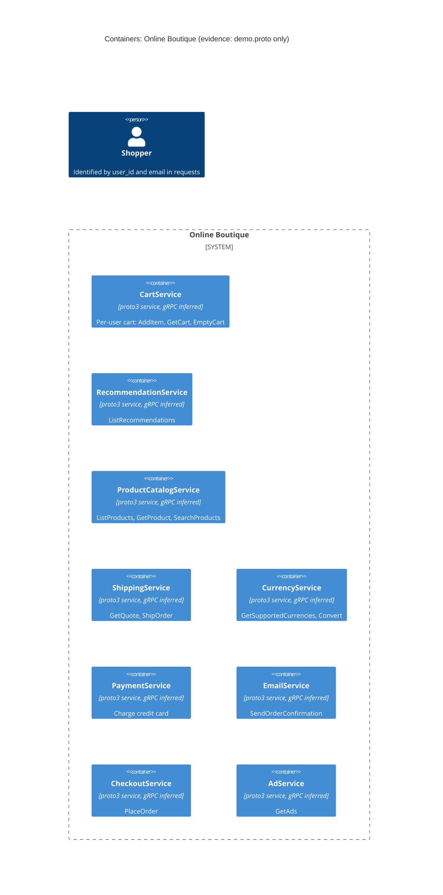

# Task 1A: Recovered architecture (C4 container level)

## 1. Agent

Claude Code (Anthropic), model Claude Opus 5.5 (`claude-opus-5-5`).

## 2. Files read

- `AGENTS.md`
- `prompts/1-recover-architecture.md`
- `system/online-boutique/protos/demo.proto` (the only evidence file)

## 3. Containers table

All containers come from the `service` blocks in `package hipstershop` (`demo.proto`, line 17). The proto file declares Protocol Buffers `service`/`rpc` interfaces. It does not name the transport. gRPC is the usual runtime for these interfaces, so that label is **[Inferred]**. Implementation languages are **Not evidenced in the provided files**.

| Container | Technology / language | Responsibility (from its RPCs) | Evidence |
|---|---|---|---|
| CartService | proto3 `service` (gRPC [Inferred]); language not evidenced | Per-user cart: `AddItem`, `GetCart`, `EmptyCart` (all keyed by `user_id`) | `system/online-boutique/protos/demo.proto` (`service CartService`, l.23-27) |
| RecommendationService | proto3 `service` (gRPC [Inferred]); language not evidenced | Recommends product IDs from a user's product list: `ListRecommendations` | `system/online-boutique/protos/demo.proto` (`service RecommendationService`, l.56-58) |
| ProductCatalogService | proto3 `service` (gRPC [Inferred]); language not evidenced | Product catalogue: `ListProducts`, `GetProduct`, `SearchProducts` | `system/online-boutique/protos/demo.proto` (`service ProductCatalogService`, l.71-75) |
| ShippingService | proto3 `service` (gRPC [Inferred]); language not evidenced | Shipping quotes and shipments: `GetQuote`, `ShipOrder` (returns `tracking_id`) | `system/online-boutique/protos/demo.proto` (`service ShippingService`, l.107-110) |
| CurrencyService | proto3 `service` (gRPC [Inferred]); language not evidenced | Currency list and conversion: `GetSupportedCurrencies`, `Convert` (ISO 4217 `Money`) | `system/online-boutique/protos/demo.proto` (`service CurrencyService`, l.140-143) |
| PaymentService | proto3 `service` (gRPC [Inferred]); language not evidenced | Charges a credit card: `Charge` (returns `transaction_id`) | `system/online-boutique/protos/demo.proto` (`service PaymentService`, l.177-179) |
| EmailService | proto3 `service` (gRPC [Inferred]); language not evidenced | Sends order confirmations: `SendOrderConfirmation` | `system/online-boutique/protos/demo.proto` (`service EmailService`, l.199-201) |
| CheckoutService | proto3 `service` (gRPC [Inferred]); language not evidenced | Places an order: `PlaceOrder` (user, currency, address, email, card → `OrderResult`) | `system/online-boutique/protos/demo.proto` (`service CheckoutService`, l.224-226) |
| AdService | proto3 `service` (gRPC [Inferred]); language not evidenced | Contextual ads: `GetAds` (by `context_keys`) | `system/online-boutique/protos/demo.proto` (`service AdService`, l.243-245) |

Data stores: **Not evidenced in the provided files.** No `ContainerDb` or `ContainerQueue` is listed.

## 4. Dependencies table

A `.proto` file declares the interfaces each service **provides**. It does not show which service **calls** which.

| Caller → callee | Protocol | Evidence |
|---|---|---|
| Not evidenced in the provided files | n/a | `demo.proto` has no client/caller information |

Note: the services share message types (`Money`, `CartItem`, `Address`, `CreditCardInfo`, `OrderResult`, `Empty`). For example, `PlaceOrderRequest` reuses `CreditCardInfo` and `Address`, and `PlaceOrderResponse` reuses `OrderResult` (l.228-239). This shows **schema coupling** inside one shared contract file. It does **not** show runtime calls, so it is not listed as a dependency.

## 5. Mermaid diagram

The diagram matches the tables: 9 containers and 0 `Rel`s, because no runtime dependency is evidenced. The `Person` is shown because requests carry `user_id` and `email` (`GetCartRequest`, `PlaceOrderRequest`). No `Rel` from the user is drawn because the entry point is not evidenced.

## 6. Gaps

| Gap | Why it is open | File(s) that would settle it |
|---|---|---|
| Who calls whom (all runtime dependencies) | Protos declare servers, not clients | Kubernetes manifests with `*_SERVICE_ADDR` env vars, e.g. `system/online-boutique/kubernetes-manifests/frontend.yaml` (path named in `AGENTS.md`; other manifests not verified) |
| User-facing entry point (web frontend) and its protocol | No frontend `service` in `demo.proto` | `system/online-boutique/kubernetes-manifests/frontend.yaml` and the frontend source |
| Transport is really gRPC | `demo.proto` declares `rpc`s but never names gRPC | Service source code or manifests (ports, gRPC health probes) |
| Implementation language per service | Only `option go_package` (l.19), which is a Go codegen option and not proof that any service is written in Go | Each service's source folder or Dockerfile (paths not verified) |
| Data stores, e.g. where carts are kept | `CartService` keeps per-user state (`user_id`). The store is **[Inferred]** to exist, but nothing names it | Cart service manifest or source |
| External systems (real payment provider, mail server) | `Charge` and `SendOrderConfirmation` might call external systems **[Inferred]**, but nothing shows it | Payment/email service source code |
| Likely call paths **[Inferred]**: CheckoutService → Cart, Catalog, Currency, Shipping, Payment, Email. Its `PlaceOrderRequest`/`OrderResult` carry the inputs and outputs of those services (l.208-239) | Message shapes suggest the calls but do not prove them | Checkout service source or `kubernetes-manifests/checkoutservice.yaml` (path not verified) |
| Message brokers / async messaging | None is declared, and the file cannot show that none exists | Manifests / deployment config |
