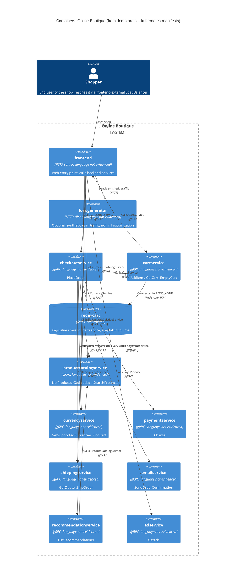

# 1B: Recovered C4 container architecture of Online Boutique

Run: **B**. Evidence: `system/online-boutique/protos/demo.proto`, `system/online-boutique/kubernetes-manifests/`

## 1. Agent

Claude Code (Anthropic), model Claude Opus 5.5 (`claude-opus-5-5`).

## 2. Files read

| # | File |
|---|------|
| 1 | `AGENTS.md` |
| 2 | `prompts/1-recover-architecture.md` |
| 3 | `system/online-boutique/protos/demo.proto` |
| 4 | `system/online-boutique/kubernetes-manifests/adservice.yaml` |
| 5 | `system/online-boutique/kubernetes-manifests/cartservice.yaml` |
| 6 | `system/online-boutique/kubernetes-manifests/checkoutservice.yaml` |
| 7 | `system/online-boutique/kubernetes-manifests/currencyservice.yaml` |
| 8 | `system/online-boutique/kubernetes-manifests/emailservice.yaml` |
| 9 | `system/online-boutique/kubernetes-manifests/frontend.yaml` |
| 10 | `system/online-boutique/kubernetes-manifests/kustomization.yaml` |
| 11 | `system/online-boutique/kubernetes-manifests/loadgenerator.yaml` |
| 12 | `system/online-boutique/kubernetes-manifests/paymentservice.yaml` |
| 13 | `system/online-boutique/kubernetes-manifests/productcatalogservice.yaml` |
| 14 | `system/online-boutique/kubernetes-manifests/recommendationservice.yaml` |
| 15 | `system/online-boutique/kubernetes-manifests/shippingservice.yaml` |
| 16 | `system/online-boutique/kubernetes-manifests/README.md` |

I also listed (Glob) `system/online-boutique/kubernetes-manifests/` to find the files above. I opened nothing else.

## 3. Containers table

Notes:
- **Language:** none of the evidence shows the implementation language. Every `image:` is a bare name, e.g. `image: cartservice`, and `kubernetes-manifests/README.md` says skaffold fills in the real image tags. So the language is "Not evidenced in the provided files" for every service below.
- **gRPC:** a service is marked gRPC when its manifest has a `grpc` Service port name **and** `grpc:` readiness/liveness probes.
- **Proto mapping:** each Deployment is matched to a `demo.proto` service by name (e.g. `cartservice` ↔ `hipstershop.CartService`). **[Inferred]**: no manifest refers to `demo.proto`.

| Container | Technology / language | Responsibility | Evidence |
|---|---|---|---|
| `frontend` | HTTP server on port 8080. Language: Not evidenced in the provided files | Web entry point. The only workload exposed outside the cluster (Service `frontend-external`, `type: LoadBalancer`, port 80→8080). Has session cookie `shop_session-id` (probe headers). Calls 7 backend services. No `demo.proto` service: it is the HTTP front end | `system/online-boutique/kubernetes-manifests/frontend.yaml` (Deployment `frontend`, `httpGet` `/_healthz` L50-65, Service `frontend-external` L123-136) |
| `checkoutservice` | gRPC server :5050. Language: Not evidenced | Places orders: `PlaceOrder(PlaceOrderRequest{user_id, user_currency, address, email, credit_card})` → `OrderResult` | `system/online-boutique/kubernetes-manifests/checkoutservice.yaml` (Service port `grpc` 5050, `grpc` probes L48-53); `system/online-boutique/protos/demo.proto` (`service CheckoutService` L224-226) |
| `cartservice` | gRPC server :7070. Language: Not evidenced | Shopping cart per `user_id`: `AddItem`, `GetCart`, `EmptyCart` | `system/online-boutique/kubernetes-manifests/cartservice.yaml` (Service port `grpc` 7070, `REDIS_ADDR` L50-51); `system/online-boutique/protos/demo.proto` (`service CartService` L23-27) |
| `redis-cart` | Redis (`image: redis:alpine`), port 6379 | Key-value store used by `cartservice`. That it holds cart contents is **[Inferred]** from the name and `REDIS_ADDR`. Data volume is `emptyDir`, so the data is lost when the pod is rescheduled (no persistent volume) | `system/online-boutique/kubernetes-manifests/cartservice.yaml` (Deployment `redis-cart` L89-141, `emptyDir` L139-141, Service port `tcp-redis` 6379 L154-156) |
| `productcatalogservice` | gRPC server :3550. Language: Not evidenced | Product catalog: `ListProducts`, `GetProduct`, `SearchProducts` | `system/online-boutique/kubernetes-manifests/productcatalogservice.yaml` (Service port `grpc` 3550); `system/online-boutique/protos/demo.proto` (`service ProductCatalogService` L71-75) |
| `currencyservice` | gRPC server :7000. Language: Not evidenced | Currency conversion: `GetSupportedCurrencies`, `Convert` (ISO 4217 `Money`) | `system/online-boutique/kubernetes-manifests/currencyservice.yaml` (Service port `grpc` 7000); `system/online-boutique/protos/demo.proto` (`service CurrencyService` L140-143) |
| `paymentservice` | gRPC server :50051. Language: Not evidenced | Charges a credit card: `Charge(ChargeRequest{amount, credit_card})` → `transaction_id` | `system/online-boutique/kubernetes-manifests/paymentservice.yaml` (Service port `grpc` 50051); `system/online-boutique/protos/demo.proto` (`service PaymentService` L177-179) |
| `shippingservice` | gRPC server :50051. Language: Not evidenced | Shipping quotes and shipment: `GetQuote`, `ShipOrder` → `tracking_id` | `system/online-boutique/kubernetes-manifests/shippingservice.yaml` (Service port `grpc` 50051); `system/online-boutique/protos/demo.proto` (`service ShippingService` L107-110) |
| `emailservice` | gRPC server: Service :5000 → container :8080. Language: Not evidenced | Order confirmation: `SendOrderConfirmation(email, OrderResult)` | `system/online-boutique/kubernetes-manifests/emailservice.yaml` (Service port `grpc` 5000→`targetPort` 8080 L81-83); `system/online-boutique/protos/demo.proto` (`service EmailService` L199-201) |
| `recommendationservice` | gRPC server :8080. Language: Not evidenced | Recommendations: `ListRecommendations(user_id, product_ids)` → `product_ids` | `system/online-boutique/kubernetes-manifests/recommendationservice.yaml` (Service port `grpc` 8080); `system/online-boutique/protos/demo.proto` (`service RecommendationService` L56-58) |
| `adservice` | gRPC server :9555. Language: Not evidenced | Contextual ads: `GetAds(context_keys)` → `Ad{redirect_url, text}` | `system/online-boutique/kubernetes-manifests/adservice.yaml` (Service port `grpc` 9555); `system/online-boutique/protos/demo.proto` (`service AdService` L243-245) |
| `loadgenerator` | HTTP client (`image: loadgenerator`, init container `busybox`). Language: Not evidenced | Synthetic user traffic to `frontend` (`USERS=10`, `RATE=1`). **Optional:** it is commented out of `kustomization.yaml` resources, so the default kustomize build does not deploy it | `system/online-boutique/kubernetes-manifests/loadgenerator.yaml` (L80-87); `system/online-boutique/kubernetes-manifests/kustomization.yaml` (L24 `# - loadgenerator.yaml`) |

All backend Services are `type: ClusterIP`, i.e. reachable only inside the cluster (each `*.yaml` Service spec).

## 4. Dependencies table

The callee's protocol comes from its manifest (Service port name `grpc`/`http`/`tcp-redis` plus probe type). Every RPC in `demo.proto` is unary request/response. There is no `stream` keyword, and the evidence shows no message broker, so **all evidenced communication is synchronous**.

| # | Caller → callee | Protocol | Evidence (file + env var / symbol) |
|---|---|---|---|
| 1 | Shopper → `frontend` | HTTP | `system/online-boutique/kubernetes-manifests/frontend.yaml` (Service `frontend-external`, `type: LoadBalancer`, port `http` 80→8080, L123-136) |
| 2 | `loadgenerator` → `frontend` | HTTP | `system/online-boutique/kubernetes-manifests/loadgenerator.yaml` (`FRONTEND_ADDR=frontend:80` L82-83; init container `wget http://${FRONTEND_ADDR}` L49) |
| 3 | `frontend` → `productcatalogservice` | gRPC | `system/online-boutique/kubernetes-manifests/frontend.yaml` (`PRODUCT_CATALOG_SERVICE_ADDR=productcatalogservice:3550` L69-70) |
| 4 | `frontend` → `currencyservice` | gRPC | `system/online-boutique/kubernetes-manifests/frontend.yaml` (`CURRENCY_SERVICE_ADDR=currencyservice:7000` L71-72) |
| 5 | `frontend` → `cartservice` | gRPC | `system/online-boutique/kubernetes-manifests/frontend.yaml` (`CART_SERVICE_ADDR=cartservice:7070` L73-74) |
| 6 | `frontend` → `recommendationservice` | gRPC | `system/online-boutique/kubernetes-manifests/frontend.yaml` (`RECOMMENDATION_SERVICE_ADDR=recommendationservice:8080` L75-76) |
| 7 | `frontend` → `shippingservice` | gRPC | `system/online-boutique/kubernetes-manifests/frontend.yaml` (`SHIPPING_SERVICE_ADDR=shippingservice:50051` L77-78) |
| 8 | `frontend` → `checkoutservice` | gRPC | `system/online-boutique/kubernetes-manifests/frontend.yaml` (`CHECKOUT_SERVICE_ADDR=checkoutservice:5050` L79-80) |
| 9 | `frontend` → `adservice` | gRPC | `system/online-boutique/kubernetes-manifests/frontend.yaml` (`AD_SERVICE_ADDR=adservice:9555` L81-82) |
| 10 | `checkoutservice` → `productcatalogservice` | gRPC | `system/online-boutique/kubernetes-manifests/checkoutservice.yaml` (`PRODUCT_CATALOG_SERVICE_ADDR=productcatalogservice:3550` L57-58) |
| 11 | `checkoutservice` → `shippingservice` | gRPC | `system/online-boutique/kubernetes-manifests/checkoutservice.yaml` (`SHIPPING_SERVICE_ADDR=shippingservice:50051` L59-60) |
| 12 | `checkoutservice` → `paymentservice` | gRPC | `system/online-boutique/kubernetes-manifests/checkoutservice.yaml` (`PAYMENT_SERVICE_ADDR=paymentservice:50051` L61-62) |
| 13 | `checkoutservice` → `emailservice` | gRPC | `system/online-boutique/kubernetes-manifests/checkoutservice.yaml` (`EMAIL_SERVICE_ADDR=emailservice:5000` L63-64) |
| 14 | `checkoutservice` → `currencyservice` | gRPC | `system/online-boutique/kubernetes-manifests/checkoutservice.yaml` (`CURRENCY_SERVICE_ADDR=currencyservice:7000` L65-66) |
| 15 | `checkoutservice` → `cartservice` | gRPC | `system/online-boutique/kubernetes-manifests/checkoutservice.yaml` (`CART_SERVICE_ADDR=cartservice:7070` L67-68) |
| 16 | `recommendationservice` → `productcatalogservice` | gRPC | `system/online-boutique/kubernetes-manifests/recommendationservice.yaml` (`PRODUCT_CATALOG_SERVICE_ADDR=productcatalogservice:3550` L60-61) |
| 17 | `cartservice` → `redis-cart` | Redis over TCP | `system/online-boutique/kubernetes-manifests/cartservice.yaml` (`REDIS_ADDR=redis-cart:6379` L50-51; Service port `tcp-redis` L154) |

The env vars name a callee and its port. They do **not** say which RPCs each caller uses. For example, it is Not evidenced in the provided files whether `frontend` calls `GetQuote` or `ShipOrder` on `shippingservice`.

`productcatalogservice`, `currencyservice`, `paymentservice`, `shippingservice`, `emailservice` and `adservice` have no `*_ADDR` env vars, so the evidence shows no outgoing dependencies for them.

## 5. Mermaid diagram

No `System_Ext` appears: the evidence shows no active external system. See the Gaps for candidates that were referenced but not proven.

## 6. Gaps

| Gap | What the evidence shows | File that would settle it |
|---|---|---|
| Implementation language/framework of every service | Only bare image names (`image: frontend`, …). README says skaffold inserts the real image tags | Each service's `Dockerfile` / build files under `system/online-boutique/src/<service>/`. The skaffold config that the comment in `kustomization.yaml` L24 refers to |
| Which RPCs each caller actually invokes (e.g. does `frontend` call `ShipOrder` or only `GetQuote`; what checkout does with `cartservice`) | Only `*_ADDR` env vars and the callee's proto interface | Caller source, e.g. `system/online-boutique/src/frontend/`, `system/online-boutique/src/checkoutservice/` |
| `shoppingassistantservice` | `frontend.yaml` sets `SHOPPING_ASSISTANT_SERVICE_ADDR=shoppingassistantservice:80` (L83-84). There is no manifest for it in this folder, `ENABLE_ASSISTANT` is commented out (L93-94), and the `shopping-assistant` component is commented out in `kustomization.yaml` (L35). Left out of the diagram | `system/online-boutique/kustomize/components/shopping-assistant/` |
| Packaging service (external, HTTP) | `PACKAGING_SERVICE_URL` is commented out in `frontend.yaml` (L97-99), so it is not active | `frontend` source that reads `PACKAGING_SERVICE_URL` |
| Data source of `productcatalogservice`, `currencyservice`, `adservice`, `recommendationservice` | No database env vars or volumes. `alloydb` and `spanner` components are commented out (`kustomization.yaml` L34, L36) | Service source under `system/online-boutique/src/<service>/`; `system/online-boutique/kustomize/components/alloydb/`, `.../spanner/` |
| Whether `paymentservice` calls a real payment provider | Proto has `CreditCardInfo` and `transaction_id`. No outgoing address or credentials in the manifest | `system/online-boutique/src/paymentservice/` |
| Whether `emailservice` really sends mail (SMTP/external provider) | No SMTP/provider env vars | `system/online-boutique/src/emailservice/` |
| Whether `shippingservice` calls an external carrier | No outgoing env vars | `system/online-boutique/src/shippingservice/` |
| Managed Redis instead of `redis-cart` | `memorystore` component is commented out (`kustomization.yaml` L32). That it would replace `redis-cart` is **[Inferred]** from the name | `system/online-boutique/kustomize/components/memorystore/` |
| Observability/profiling backend (external) | `ENABLE_PROFILER=0` (`frontend.yaml` L89-90) and `DISABLE_PROFILER=1` in the other services. `google-cloud-operations` component is commented out (L31) | `system/online-boutique/kustomize/components/google-cloud-operations/` |
| Service mesh / mTLS / network policies | Annotation `sidecar.istio.io/rewriteAppHTTPProbers: "true"` (`frontend.yaml` L30, `loadgenerator.yaml` L30) hints that Istio may be used **[Inferred]**. `network-policies` component is commented out (L33). No TLS anywhere: the shopper reaches the frontend on HTTP port 80 | Any Istio manifests in the repo; `system/online-boutique/kustomize/components/network-policies/` |
| Replicas / autoscaling | No `replicas` field or HPA, except `loadgenerator` `replicas: 1` (L24) | Deployment overlays or HPA manifests (none in evidence) |
| Exact deployed images/versions | README: manifests are "not directly deployable", use `/release` | The `release/` manifests referenced in `kubernetes-manifests/README.md` |
